# Romance Reader Intelligence: An MCP-Powered Book Discovery, Recommendation and Reader Analytics System

[](https://www.python.org/)
[](https://py.sdk.modelcontextprotocol.io/)
[](https://sites.google.com/eng.ucsd.edu/ucsdbookgraph/home)
[](#10-testing--verification)
[](#1-system-architecture)

**Romance Reader Intelligence** is a modular Model Context Protocol (MCP) server built with Python 3.13 and the official **MCP Python SDK v2** (`mcp.server.mcpserver.MCPServer`).

Rather than a conventional website with AI added as an afterthought, this project is built from the protocol layer up to expose book discovery, romance trope intelligence, content-collaborative hybrid recommendations, reader interaction analytics, and sentiment-thematic review mining directly to compatible AI hosts—including **Cline in VS Code**, **Claude Desktop**, **ChatGPT Desktop**, **Cursor**, and **Antigravity**.

---

## Table of Contents
1. [System Architecture](#1-system-architecture)
2. [Key Capabilities & Innovations](#2-key-capabilities--innovations)
3. [Dataset Attribution & Academic Licensing](#3-dataset-attribution--academic-licensing)
4. [Project Structure](#4-project-structure)
5. [Quickstart & Installation](#5-quickstart--installation)
6. [AI Client Integration Guides](#6-ai-client-integration-guides)
   - [A. Cline (VS Code In-Editor Agent)](#a-cline-vs-code-in-editor-agent---recommended)
   - [B. Claude Desktop (Local STDIO)](#b-claude-desktop-local-stdio)
   - [C. ChatGPT Desktop & Remote AI (Streamable HTTP)](#c-chatgpt-desktop--remote-ai-streamable-http)
   - [D. Official MCP Inspector](#d-official-mcp-inspector-browser-ui)
7. [MCP Capabilities Reference](#7-mcp-capabilities-reference)
   - [12 MCP Tools](#71-mcp-tools-12)
   - [5 MCP Resources](#72-mcp-resources-5)
   - [5 MCP Prompts](#73-mcp-prompts-5)
8. [Recommendation Engine & Evaluation](#8-recommendation-engine--evaluation)
9. [Romance Trope & Review Intelligence](#9-romance-trope--review-intelligence)
10. [Testing & Verification](#10-testing--verification)
11. [Definition of Completion Scenario](#11-definition-of-completion-scenario)

---

## 1. System Architecture

```mermaid
flowchart TD
    subgraph Clients ["AI Clients / MCP Hosts"]
        Cline["Cline (VS Code Extension)"]
        Claude["Claude Desktop"]
        ChatGPT["ChatGPT Desktop / Web"]
        Cursor["Cursor / Antigravity IDE"]
    end

    subgraph Protocol ["MCP Protocol Layer (mcp.server.mcpserver.MCPServer)"]
        STDIO["STDIO Transport (JSON-RPC 2.0 via stdin/stdout)"]
        HTTP["Streamable HTTP / SSE Transport (:8000)"]

        subgraph Capabilities ["Registered Capabilities"]
            Tools["12 MCP Tools<br/>• search_books<br/>• get_book_details<br/>• find_books_by_tropes<br/>• compare_books<br/>• get_author_insights<br/>• recommend_similar_books<br/>• get_personalized_recommendations<br/>• get_popular_books<br/>• analyse_book_reviews<br/>• get_reader_insights<br/>• get_genre_insights<br/>• get_catalogue_statistics"]
            Resources["5 Read-Only Resources<br/>• books://catalog/statistics<br/>• books://genres<br/>• books://tropes<br/>• books://authors/top-rated<br/>• books://analytics/overview"]
            Prompts["5 Guided Prompts<br/>• book_discovery_guide<br/>• romance_trope_explorer<br/>• book_review_analysis<br/>• reading_profile_analysis<br/>• compare_romance_books"]
        end
    end

    subgraph Domain ["Service Domain Layer"]
        BookSvc["BookService"]
        RecSvc["RecommendationService"]
        NLPSvc["NLPService"]
        OLSvc["OpenLibraryService"]
    end

    subgraph Engines ["Computational & ML Engines"]
        direction LR
        PopEngine["Popularity Engine<br/>(Bayesian Shrinkage)"]
        ContentEngine["Content Engine<br/>(TF-IDF + Cosine)"]
        CollabEngine["Collaborative Filtering<br/>(Sparse Item-Item CSR)"]
        HybridEngine["Hybrid Engine<br/>(Cold-Start Resilient)"]
        TropeEngine["Trope Extractor<br/>(10 Tropes + Evidence)"]
        SentimentEngine["Review Engine<br/>(Sentiment + Themes)"]
    end

    subgraph Storage ["Persistence Layer"]
        SQLite[("Indexed SQLite Database<br/>romance_books.db")]
        Parquet["Parquet Intermediates"]
        Reports["EDA & Evaluation Reports"]
    end

    Clients <-->|JSON-RPC 2.0| STDIO
    Clients <-->|HTTP / Tunnel| HTTP
    STDIO --> Capabilities
    HTTP --> Capabilities
    Capabilities --> Domain
    Domain --> Engines
    Engines --> Storage
```



---

## 2. Key Capabilities & Innovations

- **Grounded Recommendations**: Book recommendations, tropes, and review excerpts are drawn directly from the database catalogue. Responses cite existing records, similarity scores, and evidential text excerpts.
- **Protocol Hygiene**: When running over STDIO, `sys.stdout` is strictly reserved for pure JSON-RPC 2.0 protocol packets. All operational logging is safely directed to `sys.stderr` to prevent stream corruption.
- **Memory Discipline**: Avoids loading multi-million-row interaction matrices into dense RAM. Uses `scipy.sparse.csr_matrix` for item-item collaborative filtering and chunked generators for streaming dataset ingestion.
- **Cold-Start Resilience**: The recommendation engine gracefully detects when a reader has sparse or no history (< 2 ratings), providing informative diagnostic messages and smoothly falling back to content-based or Bayesian popularity ranking.
- **Full Traceability**: Trope classifications track their extraction method (`rule_based_keyword`, `tfidf_matcher`, or `hybrid`) alongside exact textual excerpts from book descriptions and reader shelf tags.

---

## 3. Dataset Attribution & Academic Licensing

This project is designed around the schema and domain of the **UCSD Goodreads Book Graph (Romance Subset)** developed by Mengting Wan and Julian McAuley:
- **Reference**: Wan, Mengting, and Julian McAuley. *"Item Recommendation on Monotonic Behavior Chains."* Proceedings of the 12th ACM Conference on Recommender Systems (RecSys 2018).
- **Homepage**: [UCSD Book Graph Project](https://sites.google.com/eng.ucsd.edu/ucsdbookgraph/home)
- **Dataset Portal**: [UCSD Book Graph Downloads](https://mcauleylab.ucsd.edu/public_datasets/gdrive/goodreads/UCSD%20Book%20Graph.html)

### Published UCSD Dataset Statistics (Romance Subset)
- **335,449** romance book records
- **42,792,856** romance reader-book interactions
- **3,565,378** detailed reader reviews

### Development Sample vs. Full UCSD Dataset
- **Local Development Sample**: For lightweight development, testing, and CI, the repository includes a curated local sample (`data/raw/sample_books.json.gz`, `data/raw/sample_interactions.json.gz`, `data/raw/sample_reviews.json.gz`). This sample contains 20 canonical romance titles along with synthetic reader interactions and synthetic review texts designed to exercise cold-start boundaries and NLP pipelines. Synthetic interactions are test artifacts and do not represent actual Goodreads user activity.
- **Full UCSD Ingestion (Optional)**: The streaming dataset reader (`ingestion/dataset_manager.py`) supports downloading and streaming the full multi-gigabyte UCSD `.json.gz` archives. Full UCSD dataset ingestion has not been run or performance-validated locally.
- **Dataset Mode Configuration**: In `ingestion/dataset_manager.py`, the ingestion mode can be explicitly set:
  - `development_sample`: Forces the pipeline to use the local development sample files.
  - `full_dataset`: Requires and ingests the full UCSD dataset files, raising a validation error if files are missing.
  - `auto`: Automatically detects available files, prioritizing the full dataset when present.

### Compliance & Restrictions
- Strictly for academic research and educational use. Direct scraping and redistribution are prohibited.
- Raw `.json.gz` archives are excluded from Git via `.gitignore`.

---

## 4. Project Structure

```text
romance-reader-intelligence/
├── server.py                  # Main MCP Server entrypoint (STDIO & Streamable HTTP)
├── pyproject.toml             # Packaging, dependencies, and test configuration
├── README.md                  # Comprehensive documentation and integration guide
├── PROJECT_CONTEXT.md         # Persistent architectural context
├── PROJECT_STATUS.md          # Real-time implementation and milestone tracking
├── .env.example               # Environment variable templates
├── .gitignore                 # Excludes raw data, models, and cache
│
├── config/                    # Centralized settings and stderr logging
│   ├── __init__.py
│   └── settings.py
│
├── data/                      # Local storage (omitted from VCS)
│   ├── raw/                   # Raw UCSD gzip archives or seed samples
│   ├── processed/             # Cleaned Parquet files and SQLite database
│   └── external/              # Cached Open Library lookups
│
├── database/                  # SQLite schema, connection factory, and repository
│   ├── __init__.py
│   ├── schema.sql             # Indexed DDL tables (books, interactions, reviews, tropes)
│   ├── connection.py          # Thread-safe WAL connection manager
│   └── repository.py          # Parameterized query repository
│
├── ingestion/                 # Acquisition, streaming, and schema inspection
│   ├── __init__.py
│   ├── dataset_manager.py     # Chunk-based streaming reader
│   └── seed_data.py           # Canonical romance literature dataset
│
├── preprocessing/             # Independent dataset cleaners and report generators
│   ├── __init__.py
│   └── preprocessor.py        # Data validation and Bayesian shrinkage calculations
│
├── recommendation/            # Multi-tier recommendation architectures
│   ├── __init__.py
│   ├── popularity.py          # Bayesian Weighted Rating baseline
│   ├── content_based.py       # TF-IDF & Cosine similarity with trope filtering
│   ├── collaborative.py       # Sparse CSR user-item collaborative filtering
│   ├── hybrid.py              # Weighted hybrid recommender with cold-start fallback
│   └── evaluator.py           # User-aware train/test benchmark evaluation
│
├── nlp/                       # NLP intelligence engines
│   ├── __init__.py
│   ├── trope_extractor.py     # 10 canonical romance tropes with evidence tracking
│   ├── sentiment_analyzer.py  # Lexicon-based sentiment engine with boosters & negation
│   └── theme_extractor.py     # Thematic narrative extraction (pacing, character, plot)
│
├── services/                  # Decoupled domain service layer
│   ├── __init__.py
│   ├── book_service.py        # Book search, details, and comparison
│   ├── recommendation_service.py # Recommendation orchestration
│   ├── nlp_service.py         # Trope and review query service
│   └── openlibrary_service.py # Secondary metadata lookup with rate limiting
│
├── mcp_server/                # Protocol registration layer
│   ├── __init__.py
│   ├── tools/                 # 12 Tool registrations across 4 domains
│   ├── resources/             # 5 Read-only resource URI handlers
│   └── prompts/               # 5 Guided interactive prompts
│
├── reports/                   # Generated reports and analytical artifacts
│   ├── data_dictionary.md     # Official table and field specifications
│   ├── data_validation_report.md # Processing audit log
│   ├── exploratory_data_analysis.md # Statistical summary of 10 dimensions
│   ├── recommendation_evaluation.md # Offline model benchmark metrics
│   └── figures/               # 5 Generated visualization charts
│
├── scripts/                   # Executable workflows and utilities
│   ├── run_pipeline.py        # End-to-end data pipeline runner
│   ├── demo_query.py          # Interactive terminal query demo
│   └── test_inspector.py      # Automated STDIO JSON-RPC 2.0 integration tester
│
└── tests/                     # Test suite (37 tests)
    ├── conftest.py            # Test fixtures and server lifecycle
    ├── test_book_tools.py
    ├── test_database_integrity.py
    ├── test_e2e_scenario.py   # Full Section 11 completion scenario test
    ├── test_mcp_protocol.py
    ├── test_nlp_intelligence.py
    ├── test_recommendation_evaluation.py
    ├── test_recommendation_tools.py
    └── test_review_analytics_tools.py
```

---

## 5. Quickstart & Installation

### Requirements
- **Python**: 3.11, 3.12, or 3.13
- **OS**: Windows, macOS, or Linux

### Step 1: Clone and Set Up Virtual Environment
```bash
git clone <repository-url>
cd "mcp books"
python -m venv .venv

# On Windows:
.venv\Scripts\activate
# On macOS / Linux:
source .venv/bin/activate
```

### Step 2: Install Dependencies
```bash
pip install -e ".[dev]"
```

### Step 3: Run the Ingestion, NLP & Modeling Pipeline
```bash
python scripts/run_pipeline.py
```
**What happens in ~5 seconds:**
1. Sets up the indexed SQLite database at `data/processed/romance_books.db`.
2. Validates and ingests cleaned books, reader interactions, and reviews.
3. Runs the **Trope Extraction Engine** (extracting 10 tropes across all titles).
4. Runs the **Review Sentiment & Thematic Engine** (sentiment scores and pacing/character/plot themes).
5. Generates **5 evaluation and EDA charts** in `reports/figures/`.
6. Executes the **Recommendation Benchmark** using a user-aware train/test split.

### Step 4: Quick Interactive Terminal Demo
Test the server without needing an AI client:
```bash
python scripts/demo_query.py
```

---

## 6. AI Client Integration Guides

### A. Cline (VS Code In-Editor Agent) - *Recommended*

Running the MCP server directly inside VS Code with **Cline** gives you an in-editor pair programmer that can query romance literature without switching windows.

1. **Install Cline**:
   - In VS Code, press `Ctrl + Shift + X`.
   - Search for **`Cline`** (by *saoudrizwan*, with the robot icon 🤖).
   - Click **Install**.
2. **Open MCP Settings**:
   - Click the **Robot icon 🤖** on your far-left VS Code activity bar.
   - Click the **MCP Servers icon** (the plug/server rack `🔌`/`🖥️`) at the top of the Cline sidebar (or click the Settings gear `⚙️` ➔ MCP Servers).
   - Click **"Configure MCP Servers"**.
3. **Paste the Server Configuration**:
   VS Code will open `cline_mcp_settings.json`. Paste this configuration (replace `<path-to-python-executable>` with your `.venv` Python path and `<path-to-repository-root>` with the absolute path to your cloned repository):
   ```json
   {
     "mcpServers": {
       "romance-reader-intelligence": {
         "command": "<path-to-python-executable>",
         "args": [
           "<path-to-repository-root>/server.py",
           "--transport",
           "stdio"
         ],
         "env": {
           "PYTHONPATH": "<path-to-repository-root>"
         },
         "disabled": false,
         "alwaysAllow": [
           "search_books",
           "get_book_details",
           "find_books_by_tropes",
           "compare_books",
           "get_author_insights",
           "recommend_similar_books",
           "get_personalized_recommendations",
           "get_popular_books",
           "analyse_book_reviews",
           "get_reader_insights",
           "get_genre_insights",
           "get_catalogue_statistics"
         ]
       }
     }
   }
   ```
   > **Example paths**:
   > - Windows: `"command": "C:/path/to/project/.venv/Scripts/python.exe"`
   > - macOS / Linux: `"command": "/path/to/project/.venv/bin/python"`

4. **Save and Chat**:
   - Save the file (`Ctrl + S`).
   - You will see `romance-reader-intelligence` light up with a **green status dot**.
   - Switch back to the chat tab in Cline and type your prompt!

---

### B. Claude Desktop (Local STDIO)

1. Open your Claude Desktop configuration file:
   - **Windows**: `%APPDATA%\Claude\claude_desktop_config.json`
   - **macOS**: `~/Library/Application Support/Claude/claude_desktop_config.json`
2. Add the server entry (substituting your virtual environment's Python path and project root):
   ```json
   {
     "mcpServers": {
       "romance-reader-intelligence": {
         "command": "<path-to-python-executable>",
         "args": [
           "<path-to-repository-root>/server.py",
           "--transport",
           "stdio"
         ],
         "env": {
           "PYTHONPATH": "<path-to-repository-root>"
         }
       }
     }
   }
   ```
3. **Restart Claude Desktop**:
   > [!IMPORTANT]
   > Claude Desktop only reads this file on boot. Completely quit Claude from your Windows system tray (bottom-right near your clock) and restart it.
4. Go to **Settings (⚙️)** ➔ **Developer** to verify the green status light, or click the **Hammer icon 🔨** in chat to see all 12 tools.

---

### C. ChatGPT Desktop & Remote AI (Streamable HTTP)

Unlike Claude Desktop (which runs local processes via STDIO), **ChatGPT Desktop** and web clients communicate with MCP servers over **HTTPS**.

1. **Start the server in Streamable HTTP mode**:
   ```bash
   python server.py --transport streamable-http --port 8000
   ```
2. **Expose port 8000 to HTTPS (Using localtunnel or ngrok)**:
   ```bash
   # Zero-install option using Node:
   npx localtunnel --port 8000
   
   # Or using ngrok:
   winget install --id Ngrok.Ngrok -e
   ngrok http 8000
   ```
   *Note the forwarding URL (e.g., `https://your-tunnel.loca.lt`).*
3. **Add Custom MCP Server in ChatGPT / Claude Connectors**:
   - In ChatGPT Desktop (or Claude ➔ `Add connector > ... Add custom connector`):
   - **Server URL**: `https://your-tunnel.loca.lt/mcp`
   - **Authentication**: `None`
   - Save and start chatting!

---

### D. Official MCP Inspector (Browser UI)

Test tools visually in the browser without any AI host:
```bash
npx @modelcontextprotocol/inspector python server.py --transport stdio
```

---

## 7. MCP Capabilities Reference

### 7.1 MCP Tools (12)

| # | Tool Name | Parameters | Return Type | Description |
|---|---|---|---|---|
| 1 | `search_books` | `query: str?`, `author: str?`, `genre: str?`, `publication_year: int?`, `min_rating: float?`, `limit: int = 10`, `offset: int = 0` | `dict` | Multi-filter search across romance titles, authors, and subgenres with pagination. |
| 2 | `get_book_details` | `book_id: str` | `dict` | Complete metadata, synopsis, confirmed tropes, and review sentiment summary. |
| 3 | `find_books_by_tropes` | `tropes: list[str]`, `match_all: bool = False`, `limit: int = 10` | `dict` | Searches books exhibiting specified tropes with confidence scores and evidence quotes. |
| 4 | `compare_books` | `book_id_1: str`, `book_id_2: str` | `dict` | Side-by-side comparison of two titles: ratings, shared vs. exclusive tropes, and subgenres. |
| 5 | `get_author_insights` | `author_name: str` | `dict` | Aggregated author statistics, mean reader ratings, and catalogue bibliography. |
| 6 | `recommend_similar_books` | `book_id: str?`, `query: str?`, `limit: int = 5`, `target_tropes: list[str]?` | `dict` | Content-based recommendations with TF-IDF cosine similarity and trope filtering. |
| 7 | `get_personalized_recommendations` | `user_id: str?`, `favorite_genres: list[str]?`, `desired_tropes: list[str]?`, `limit: int = 5` | `dict` | Hybrid recommendations for reader profiles with explicit cold-start resilience. |
| 8 | `get_popular_books` | `limit: int = 10`, `min_ratings: int = 100`, `genre: str?` | `dict` | Top-ranked books using Bayesian shrinkage weighted rating ($WR$). |
| 9 | `analyse_book_reviews` | `book_id: str` | `dict` | Sentiment polarity breakdown and thematic analysis across character, pacing, and plot. |
| 10 | `get_reader_insights` | `user_id: str` | `dict` | Anonymized reader history summary (reading volume, average given rating, top subgenres). |
| 11 | `get_genre_insights` | *None* | `dict` | Frequency distribution of romance subgenres across the entire catalogue. |
| 12 | `get_catalogue_statistics` | *None* | `dict` | Catalogue coverage metrics, total counts, and dataset freshness provenance. |

### 7.2 MCP Resources (5)
- `books://catalog/statistics`: Real-time catalogue metrics, average ratings, and dataset provenance.
- `books://genres`: Romance subgenre frequency distribution.
- `books://tropes`: Canonical romance trope vocabulary and keyword patterns.
- `books://authors/top-rated`: Top-rated romance authors by mean rating and reader volume.
- `books://analytics/overview`: High-level summary of catalogue coverage, subgenres, and benchmark metrics.

### 7.3 MCP Prompts (5)
- `book_discovery_guide`: Interactive guide for discovering books by mood, trope, or author.
- `romance_trope_explorer`: In-depth trope analysis citing verified classification evidence.
- `book_review_analysis`: Balanced empirical review analysis across character, pacing, and plot.
- `reading_profile_analysis`: Personalized reader concierge analyzing history and cold-start boundaries.
- `compare_romance_books`: Side-by-side comparative literary analysis.

---

## 8. Recommendation Engine & Evaluation

The server implements four independent recommendation approaches:
1. **Popularity Baseline**: Bayesian shrinkage weighted rating ($WR = \frac{v}{v+m}R + \frac{m}{v+m}C$) smoothing raw star averages against global volume to prevent low-sample bias.
2. **Content-Based Recommender**: TF-IDF vectorization with sublinear term-frequency scaling over combined descriptions, subgenres, and author tokens, ranked via cosine similarity.
3. **Collaborative Filtering**: Memory-efficient sparse CSR user-item matrix computing item-item cosine similarities without dense RAM explosion.
4. **Hybrid Recommender**: Configurable linear combination ($\alpha \cdot \text{content} + (1-\alpha) \cdot \text{collab}$) with automatic fallback to popularity or trope filtering for cold-start readers.

### Benchmark Evaluation (Development Sample Baseline)
Evaluated offline using a user-aware chronological holdout split on the local development sample without interaction leakage:

| Model Architecture | Precision@5 | Recall@5 | NDCG@5 | Catalog Coverage |
|---|---|---|---|---|
| **Popularity Baseline** | 0.0500 | 0.2500 | 0.1077 | 40.00% |
| **Collaborative Filtering (Sparse CSR)** | 0.0000 | 0.0000 | 0.0000 | 40.00% |
| **Content-Based (TF-IDF)** | 0.2000 | 1.0000 | 0.7217 | 75.00% |
| **Hybrid Recommender** | 0.1500 | 0.7500 | 0.6250 | 75.00% |

> [!NOTE]
> These metrics represent a local verification baseline computed on the 20-book development sample to validate train/test separation, metric calculation (Precision@K, Recall@K, NDCG@K), and cold-start fallback mechanics. They do not represent independently validated or generalizable production benchmarks against the full 42M-interaction UCSD dataset. Detailed methodology and sample sparsity dynamics are documented in [`reports/recommendation_evaluation.md`](reports/recommendation_evaluation.md).

---

## 9. Romance Trope & Review Intelligence

### Canonical 10-Trope Ontology
1. **Enemies to Lovers**: Sworn rivals whose banter and hostility escalate into irresistible attraction.
2. **Friends to Lovers**: Longtime best friends or childhood confidants crossing into romance.
3. **Fake Dating**: Staged romantic charade to satisfy family or external stakes that ignites genuine passion.
4. **Slow Burn**: Agonizing, deliberate romantic buildup across hundreds of pages before culmination.
5. **Second Chance Romance**: Former lovers reunited years later to confront past heartbreak and heal.
6. **Grumpy x Sunshine**: Brooding, taciturn hero paired with a cheerful, optimistic counterpart.
7. **Workplace Romance**: Tension developing in corporate, editorial, athletic, or academic settings.
8. **Forced Proximity**: Inescapable closeness (shared flat, only one bed, snowed in) breaking down emotional barriers.
9. **Marriage of Convenience**: Pragmatic, legal marriage for external reasons blossoming into true devotion.
10. **Friends with Benefits**: Strictly physical arrangement with rules that inevitably succumb to feelings.

### Review Intelligence Dimensions
- **Sentiment Polarity**: Lexicon-based VADER scoring with contextual booster (`so`, `incredibly`) and 3-word negation window (`didn't`, `never`, `barely`) handling.
- **Character Dynamics**: Tracks recurring praise and critiques (e.g., `grumpy_hero`, `relatable_heroine`, `electric_chemistry`, `childish_behavior`).
- **Narrative Pacing**: Identifies pacing feedback (e.g., `brisk_pacing`, `slow_pacing`, `dragged_middle`, `rushed_ending`).
- **Plot Construction**: Evaluates plot points (e.g., `third_act_misunderstanding`, `satisfying_payoff`, `emotional_depth`, `authentic_setting`).

---

## 10. Testing & Verification

Run the test suite:
```bash
pytest -v
```

```text
============================= test session starts =============================
platform win32 -- Python 3.13.5, pytest-9.2.0, pluggy-1.7.0
rootdir: <path-to-project-root>
configfile: pyproject.toml
testpaths: tests
plugins: asyncio-1.4.1.post1, anyio-4.10.0
collected 37 items

tests/test_book_tools.py::test_search_existing_book PASSED               [  2%]
tests/test_book_tools.py::test_search_nonexistent_book PASSED            [  5%]
tests/test_book_tools.py::test_get_book_details PASSED                   [  8%]
tests/test_book_tools.py::test_filter_books_by_rating PASSED             [ 10%]
tests/test_book_tools.py::test_retrieve_trope_based_results PASSED       [ 13%]
tests/test_book_tools.py::test_compare_two_books PASSED                  [ 16%]
tests/test_book_tools.py::test_validate_invalid_tool_inputs PASSED       [ 18%]
tests/test_database_integrity.py::test_empty_database_behavior PASSED    [ 21%]
tests/test_database_integrity.py::test_duplicate_book_id_upsert PASSED   [ 24%]
tests/test_database_integrity.py::test_foreign_key_enforcement_in_database PASSED [ 27%]
tests/test_database_integrity.py::test_preprocessor_filters_invalid_foreign_keys PASSED [ 29%]
tests/test_database_integrity.py::test_repeated_pipeline_execution_idempotency PASSED [ 32%]
tests/test_e2e_scenario.py::test_complete_user_query_scenario PASSED     [ 35%]
tests/test_mcp_protocol.py::test_mcp_tool_discovery PASSED               [ 37%]
tests/test_mcp_protocol.py::test_mcp_resource_access PASSED              [ 40%]
tests/test_mcp_protocol.py::test_mcp_prompt_retrieval PASSED             [ 43%]
tests/test_mcp_protocol.py::test_mcp_host_integration PASSED             [ 45%]
tests/test_nlp_intelligence.py::test_sentiment_positive_review PASSED    [ 48%]
tests/test_nlp_intelligence.py::test_sentiment_negative_review PASSED    [ 51%]
tests/test_nlp_intelligence.py::test_sentiment_neutral_review PASSED     [ 54%]
tests/test_nlp_intelligence.py::test_sentiment_negation_handling PASSED  [ 56%]
tests/test_nlp_intelligence.py::test_sentiment_booster_handling PASSED   [ 59%]
tests/test_nlp_intelligence.py::test_sentiment_empty_and_whitespace PASSED [ 62%]
tests/test_nlp_intelligence.py::test_trope_extraction_evidence_traceability PASSED [ 64%]
tests/test_nlp_intelligence.py::test_review_theme_extraction PASSED      [ 67%]
tests/test_recommendation_evaluation.py::test_dcg_calculation PASSED     [ 70%]
tests/test_recommendation_evaluation.py::test_idcg_and_ndcg_mathematical_correctness PASSED [ 72%]
tests/test_recommendation_evaluation.py::test_user_aware_split_disjointness PASSED [ 75%]
tests/test_recommendation_tools.py::test_recommend_similar_books PASSED  [ 78%]
tests/test_recommendation_tools.py::test_recommendations_for_known_reader PASSED [ 81%]
tests/test_recommendation_tools.py::test_handle_reader_with_insufficient_history PASSED [ 83%]
tests/test_recommendation_tools.py::test_popular_books_ranking PASSED    [ 86%]
tests/test_review_analytics_tools.py::test_analyse_existing_book_reviews PASSED [ 89%]
tests/test_review_analytics_tools.py::test_handle_books_without_review_data PASSED [ 91%]
tests/test_review_analytics_tools.py::test_retrieve_catalogue_statistics PASSED [ 94%]
tests/test_review_analytics_tools.py::test_get_author_insights PASSED    [ 97%]
tests/test_review_analytics_tools.py::test_get_reader_insights PASSED    [100%]

============================= 37 passed in 3.03s ==============================
```

Test STDIO JSON-RPC 2.0 protocol compliance:
```bash
python scripts/test_inspector.py
```

---

## 11. Definition of Completion Scenario

The system fully passes the end-to-end conversational scenario:

**User Query**:
> *"Recommend five romance books similar to The Love Hypothesis that contain workplace romance and slow-burn themes. Explain why each book was selected."*

### System Execution Trace
1. **Tool Invocation**: `search_books(query="The Love Hypothesis")` ➔ resolves `book_id: "56732449"`.
2. **Recommendation & Filtering**: `recommend_similar_books(book_id="56732449", limit=5, target_tropes=["Workplace Romance", "Slow Burn"])`.
3. **Structured Response Produced**:
   - **1. *The Spanish Love Deception* by Elena Armas**
     *Similarity*: 0.07 | *Rating*: 3.95/5.0
     *Verified Tropes*: Workplace Romance, Enemies to Lovers, Fake Dating, Slow Burn, Grumpy x Sunshine
     *Rationale*: Colleague rivals entering a fake dating arrangement for a wedding in Spain.
   - **2. *Take a Hint, Dani Brown* by Talia Hibbert**
     *Similarity*: 0.05 | *Rating*: 4.11/5.0
     *Verified Tropes*: Friends to Lovers, Fake Dating, Workplace Romance
     *Rationale*: Academic Ph.D. professor and university security guard in a fake dating arrangement.
   - **3. *The Hating Game* by Sally Thorne**
     *Similarity*: 0.03 | *Rating*: 4.12/5.0
     *Verified Tropes*: Enemies to Lovers, Slow Burn, Workplace Romance, Forced Proximity
     *Rationale*: Executive assistants competing for the same promotion in forced proximity.
   - **4. *Archer's Voice* by Mia Sheridan**
     *Similarity*: 0.03 | *Rating*: 4.19/5.0
     *Verified Tropes*: Friends to Lovers, Slow Burn
     *Rationale*: Contemporary small-town slow burn centering emotional healing.
   - **5. *Get a Life, Chloe Brown* by Talia Hibbert**
     *Similarity*: 0.03 | *Rating*: 3.98/5.0
     *Verified Tropes*: Friends to Lovers, Slow Burn, Grumpy x Sunshine, Workplace Romance, Forced Proximity
     *Rationale*: Chronic illness computer geek and building superintendent working together.

*Verified end-to-end via `tests/test_e2e_scenario.py`.*
